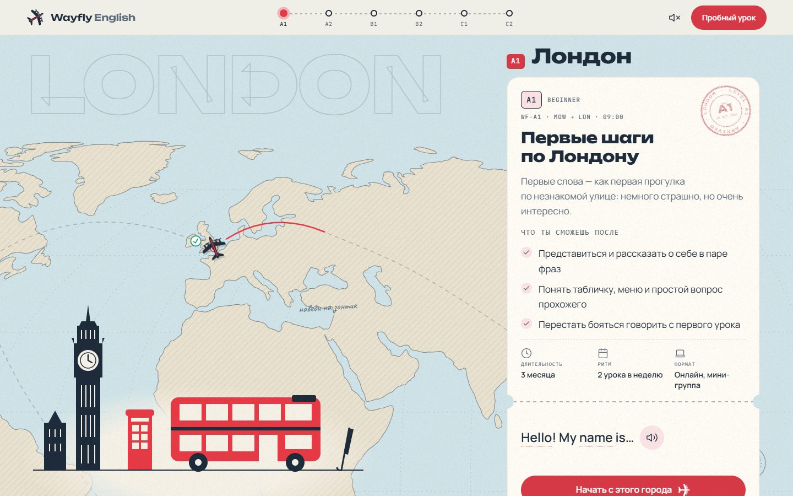
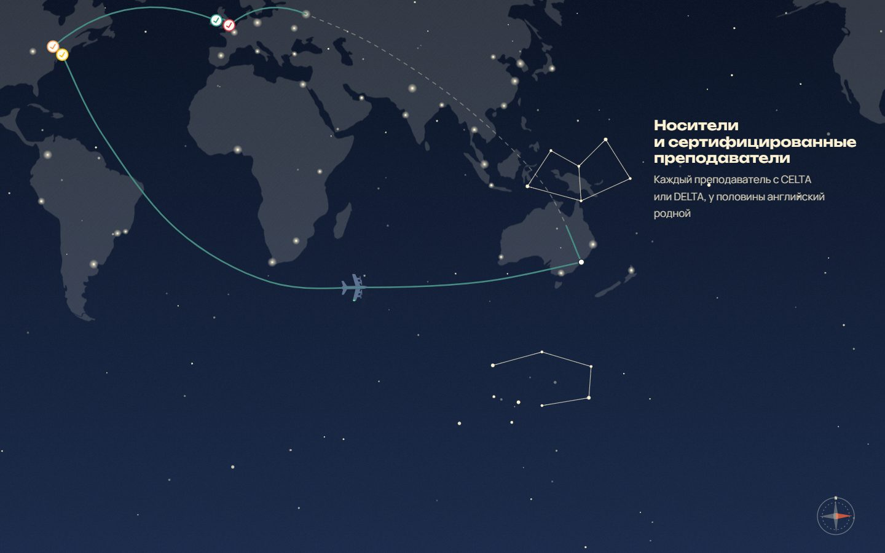
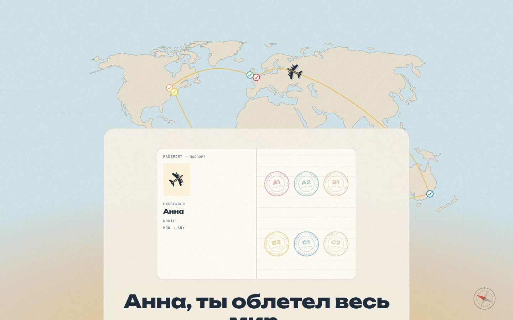
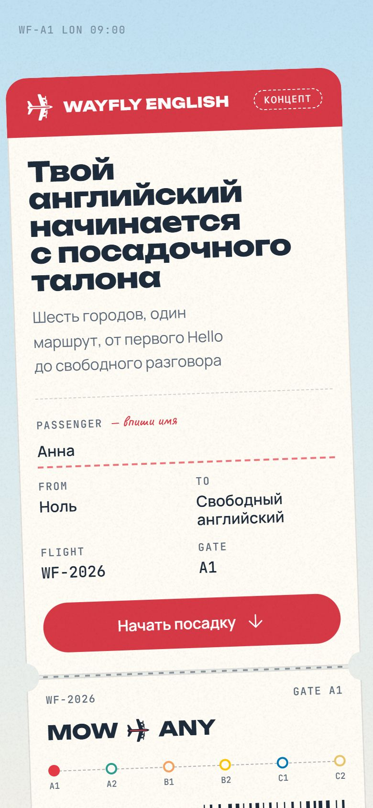
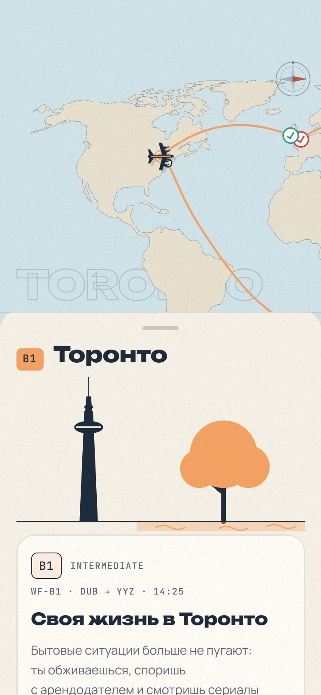
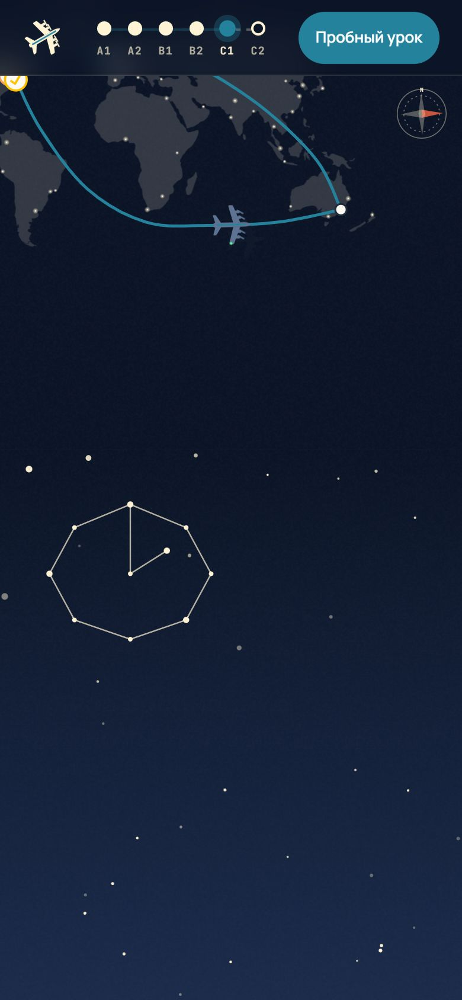

# ✈️ Wayfly English — английский как кругосветное путешествие

Демо-проект для портфолио: лендинг онлайн-школы английского, где путь ученика от нуля до свободного языка
показан как перелёт вокруг света. Листаешь страницу — самолётик летит по карте и садится в городах,
каждый город — новый уровень: Лондон A1 → Дублин A2 → Торонто B1 → Нью-Йорк B2 → Сидней C1 → весь мир C2.

### 👉 [Открыть сайт](https://forrerin.github.io/wayfly-english/)

<p align="center">
  
  
  
  
</p>

<p align="center">
  
  
  
</p>

> ⚠️ Школа вымышленная. Цены, отзывы и цифры — примеры, форма заявки в демо-версии ничего не отправляет.

---

## 🚀 Как посмотреть

**Проще всего — [открыть сайт по ссылке](https://forrerin.github.io/wayfly-english/).** Работает на компьютере и телефоне.

### Запустить у себя на компьютере (Windows, 2 шага)

Ничего устанавливать не нужно.

1. **Скачайте проект:** зелёная кнопка **Code** вверху страницы → **Download ZIP** → распакуйте архив в любую папку.
2. **Дважды кликните `start.bat`.** Откроется чёрное окно, а сайт сам откроется в браузере.

**Готово — листайте и пробуйте!** ✈️

> Сайт работает, пока открыто чёрное окно. Закрыли окно — сайт выключился.
> Чтобы включить снова, ещё раз запустите `start.bat`.

<details>
<summary>На macOS или Linux</summary>

В папке проекта выполните в терминале:

```bash
python3 -m http.server 8080
```

и откройте `http://localhost:8080/wayfly-english/`.

</details>

---

## 👆 Что попробовать

- **Впишите своё имя** в поле PASSENGER на посадочном талоне — оно появится на штампах в каждом городе и в финале.
- **Пройдите регистрацию на рейс** — три вопроса определят ваш стартовый город. В шапке появится «Ты здесь», а в карточке города — «Твоя остановка».
- **Листайте медленно:** самолёт взлетает сквозь облака, летит по маршруту, карта приближается к городам, цвет страницы меняется вместе с городом.
- **Прокрутите назад** — самолёт полетит обратно, а след сотрётся. Штампы останутся.
- **Наведите на английскую фразу** в карточке курса — появится рукописный перевод. Наведите на отдельное слово — транскрипция. Кнопка с динамиком произносит фразу. На телефоне перевод открывается касанием.
- **Ночной перелёт** Нью-Йорк → Сидней: небо темнеет, звёзды складываются в созвездия-преимущества.
- **Найдите пасхалки:** зонтик в Лондоне, чайка в Дублине, листья в Торонто, светофор в Нью-Йорке, кенгуру в Сиднее, а в финале нажмите на самолёт.
- **Переверните открытки** в отзывах и наведите на тарифы.
- **Заполните форму** в конце — увидите, как отрывается корешок талона и ставится штамп BOARDING CONFIRMED.
- Внизу страницы есть переключатель **«Анимации: вкл/выкл»** — упрощённый режим для тех, кому мешает движение.

## ❓ Если что-то не так

| Проблема | Решение |
|---|---|
| После двойного клика по `start.bat` окно сразу закрылось | Распакуйте архив полностью (не запускайте из ZIP) и попробуйте снова |
| Windows пишет «Система Windows защитила ваш компьютер» | Нажмите **Подробнее** → **Выполнить в любом случае**. Скрипт только раздаёт файлы из папки `wayfly-english` |
| Пишет «Не нашёлся свободный порт» | Закройте другие локальные серверы или перезагрузите компьютер |
| Анимации дёргаются | Откройте сайт в Chrome или Edge и закройте тяжёлые вкладки. В системе может быть включено «уменьшить движение» — тогда анимации упрощены специально |

---

## Что внутри

- **Скролл-анимация полёта:** самолёт по SVG-маршруту, всегда носом по курсу, след прорисовывается за ним, тень показывает высоту
- **Карта мира:** векторная, в проекции Робинсона, с гравюрной штриховкой, сеткой координат и огнями городов ночью
- **Шесть городов** со своим цветом, иллюстрацией, билетом курса и штампом паспортного контроля
- **Ночной перелёт:** звёздное небо на Canvas, созвездия рисуются по мере прокрутки
- **Печатная машинка** с рукописным переводом, пословными подсказками и произношением
- **Мини-тест уровня**, персонализация по имени, отзывы-открытки, тарифы-классы перелёта, FAQ, форма-талон
- **Мобильная версия** — отдельная сцена: карта сверху, карточки шторкой снизу
- **Доступность:** работа с клавиатуры, экранные дикторы, режим «меньше движения», страница читается даже без JavaScript

| Часть | Технологии |
|---|---|
| Сборка | Vite, чистые HTML / CSS / JavaScript |
| Анимации | GSAP 3 (ScrollTrigger, MotionPath, SplitText), Lenis |
| Графика | Inline SVG, Canvas 2D, иллюстрации нарисованы вручную |
| Форма | Серверная функция + Telegram Bot API (в демо отключена) |

| Lighthouse | Performance | Accessibility | Best Practices | SEO |
|---|---|---|---|---|
| Десктоп | 100 | 100 | 100 | 100 |
| Телефон | 94 | 100 | 100 | 100 |

---

## 📄 Права

Это демонстрационная версия: в репозитории лежит только собранный сайт, исходный код проекта не публикуется.
Смотреть и запускать можно, копировать и использовать код, дизайн, иллюстрации и тексты — нельзя.
Подробнее в [LICENSE](LICENSE).
